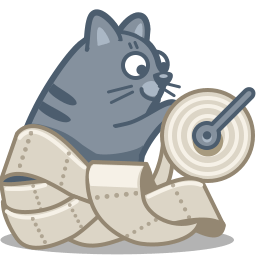

<p align="center">
  
</p>

<h1 align="center">Clowder</h1>

<p align="center"><em>A clowder is a group of cats. This is where yours check in.</em></p>

Every Litter Robot in your house knows which cat just stopped by. The trouble is that each
robot only knows its own half of the story, so a cat who uses two boxes ends up with two
weights, two visit counts and two histories.

Clowder gathers the visits from all of your robots into Home Assistant and gives each cat
**one device**: one weight, one visit count and one history, whichever box they picked today.

It is the Home Assistant half of the pair. The robot half is the
[esphome-litter-robot](https://github.com/davidcoulson/esphome-litter-robot) firmware.

## What you get

- 🐾 **A device for every cat.** Weight, a 7-day average, visits, visits per day, hours since
  the last visit, and poop and pee counts.
- 🏠 **A view of the whole house.** Which cat went last, when, how many visits today, and how
  many visits nobody could put a name to.
- 🕵️ **Mystery visitors.** When a robot can't tell who it was, Clowder fires an
  **Unidentified visit** event you can hang an automation on.
- 📬 **Nothing goes missing.** Each robot keeps a visit until Clowder confirms it has it. If
  Home Assistant is restarting or down for a while, the visits arrive when it is back and are
  counted at the time they happened.
- ⚖️ **No wild weight swings.** Two cats in the box at once, or one cat only half in? The visit
  still counts, but a weight that far off doesn't change the cat's weight.
- 🔌 **Local only.** No cloud, no account, no subscription.

A few things people use it for: a nudge when a cat hasn't visited in a day, a weight chart that
covers every box, or a heads-up when visits per day suddenly jump.

## What you need

- At least one **Litter Robot 4** running
  [esphome-litter-robot](https://github.com/davidcoulson/esphome-litter-robot) with
  **WasteSense** and the **Clowder package** (`packages/litter-robot4/clowder.yaml`). The
  Litter Robot 3 isn't supported yet.
- A robot config that tells the package which cat it was, for example from a collar tag. The
  [Clowder guide](https://github.com/davidcoulson/esphome-litter-robot/blob/main/docs/Litter%20Robot%204/Clowder.md)
  in the firmware repository walks through it.
- Home Assistant 2025.1 or newer, and [HACS](https://hacs.xyz/).

## Install

1. In HACS, add `https://github.com/davidcoulson/ha-clowder` as a custom repository
   (type: integration) and install **Clowder**.
2. Restart Home Assistant.
3. Go to Settings → Devices & services → Add integration → **Clowder**. There's nothing to
   fill in.
4. Let each robot talk to Home Assistant: Settings → Devices & services → ESPHome → your robot
   → Configure, and turn on **Allow the device to perform Home Assistant actions**. Without it,
   no visits get through.

Your cats appear as soon as a robot connects (it introduces its cats by name) or when a cat
first visits. Counts start from zero; Clowder doesn't import history from the robots.

## Meet your cat's device

| Entity | What it tells you |
|---|---|
| Weight | The latest believable weight (lb) |
| Average weight (7d) | Average of the believable weights from the last 7 days |
| Visits | Every visit since you installed Clowder or last reset this cat |
| Visits per day (7d) | Visits in the last 7 days, divided by 7 |
| Hours since last visit | How long it has been |
| Poop count, Pee count | From each robot's WasteSense verdict |
| Poop weight, Pee weight | Reserved for waste mass; the current firmware doesn't send it, so these stay empty |
| Last robot | Serial number of the robot used last |
| Set weight | Correct the cat's weight by hand |
| Tracker reset | Start this cat over: counts and history back to zero |

The **Clowder** device covers the whole household:

| Entity | What it tells you |
|---|---|
| Last cat | Who went last ("Unknown" if the robot couldn't tell) |
| Last visit | When, with the robot as an attribute |
| Visits today | Every visit since local midnight, mystery visitors included |
| Unidentified visits | Running count of visits nobody could put a name to, across all robots |
| Unidentified visit (event) | Fires for each of those, with `robot`, `weight`, `time` and `rssi` |

## Dashboard cards

Clowder comes with four cards. There is nothing to install: add a card to a dashboard and
search for "Clowder", or use the type in YAML. They find your cats and litter robots on
their own.

| Card | Shows |
| --- | --- |
| `custom:clowder-robots-card` | Each robot: status, drawer and litter level, days until the drawer is full, filter and odor |
| `custom:clowder-attention-card` | Only what needs you: a full drawer, low litter, a robot offline, a cat that has not visited, a weight change |
| `custom:clowder-strip-card` | Compact, for a wall panel: a ring per cat that fills as time since the last visit runs on, and per robot its status, the last cat in it and a drawer bar |
| `custom:clowder-share-card` | Which cats used each robot in the last 7 days, with drawer and litter level |

Options, all optional:

```yaml
type: custom:clowder-strip-card
title: Cats
overdue_hours: 18        # when a cat counts as overdue; default is three of its usual gaps, 12 to 36 hours
names:                   # a robot is named after its area unless you name it here, by serial
  LR4C000001: Basement left
robots:                  # show only these robots, by serial; default is all of them
  - LR4C000001
```

A robot is any device with a "waste drawer level" sensor. Readings a robot does not have
are left out.

## Tuning

There is one setting, under Settings → Devices & services → Clowder → Configure:

**Largest believable weight change** (default 3.0 lb, from 0.1 to 10). A visit whose weight is
further than this from the cat's current weight still counts as a visit, but doesn't change
Weight or the 7-day average.

## Good to know

- **Cat names come from the robots.** Use the same names in the same order on every robot. If
  two robots disagree about a cat's name, Clowder keeps the first one and raises a repair issue.
- **Set weight and Tracker reset only change Clowder.** The robots keep their own records and
  their own way of recognising each cat.
- **Each robot also has its own Unidentified Visits sensor**, counting only that robot.
  Clowder's sensor adds them all up.
- **One trip is one visit.** A cat that steps out and back in, or tries the box next door,
  within 5 minutes is still on the same visit: one visit and one poop or pee, with the latest
  weight. Mystery visitors aren't merged.
- **A robot holds up to 16 visits** that Clowder hasn't confirmed yet. If more pile up, the
  oldest is dropped.
- **No verdict, no poop or pee.** If WasteSense hasn't decided within 45 minutes, or the robot
  restarts while it is deciding, the visit still counts but as neither.

## Under the hood

<details>
<summary>How visits travel from the robot to Clowder</summary>

Robots fire `esphome.clowder_visit` on the Home Assistant event bus. All values are strings.

| Key | Example | Meaning |
|---|---|---|
| `node` | `litter-robot4-a1b2c3` | ESPHome device name, MAC suffix included |
| `robot` | `LR4C000001` | robot serial |
| `epoch` | `1893411021` | random per queue lifetime, 1 to 2147483647 |
| `id` | `17` | per-robot counter |
| `slot` | `4` | 1 to 6; `0` = not identified |
| `name` | `Luna` | `Unknown` for slot 0 |
| `method` | `Tag` or `None` | `Tag` for any identified visit; not used by Clowder |
| `rssi` | `-52` | strongest tag signal |
| `weight` | `11.46` | lb |
| `time` | `1795512000` | epoch seconds; `0` if the robot had no clock |
| `age` | `12` | seconds since the visit; `-1` if unknown |
| `waste` | `pending`, `feces`, `urine` | |
| `waste_weight` | `` | lb; always empty from the current firmware |
| `final` | `0` or `1` | `1` once the verdict is in |

A visit is sent as soon as the cat is weighed (`final: 0`), and again with the same `id` when
the verdict is known (`final: 1`). Clowder counts each `(robot, epoch, id)` once, however many
copies arrive, and acknowledges every final copy by calling
`esphome.<node with - as _>_clowder_ack` with `epoch` and `id`. The robot keeps the visit in
flash and resends it every minute and whenever Home Assistant connects, until it is
acknowledged.

Robots also fire `esphome.clowder_hello` when they connect (`node`, `robot`,
`cats: "1=Ash,2=Bean,..."`), so the cat devices exist before the first visit.

</details>

<details>
<summary>Development</summary>

```bash
pip install -r requirements_test.txt ruff
pytest
ruff check . && ruff format --check .
```

</details>
